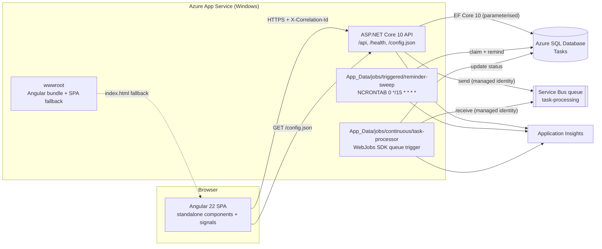
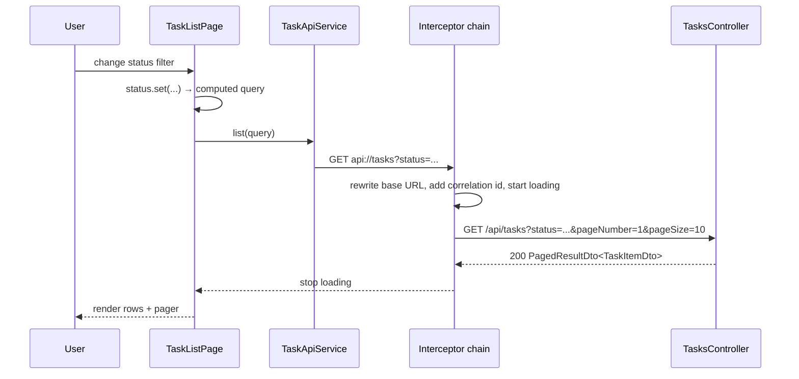
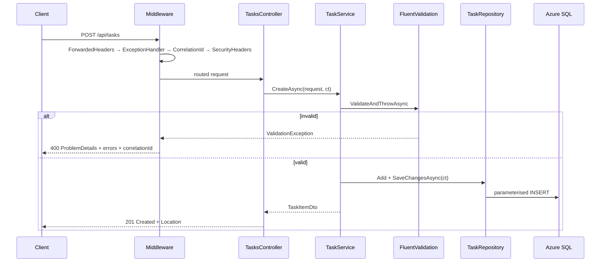
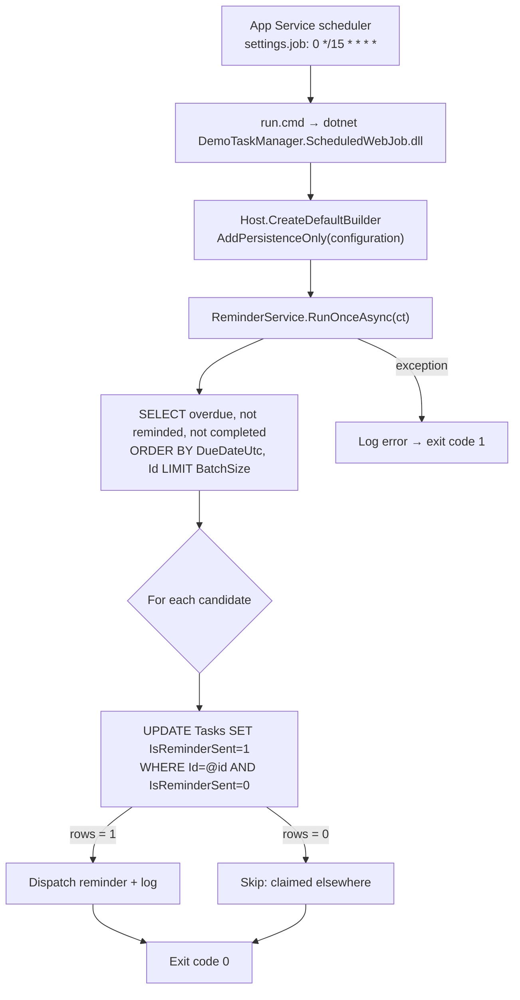
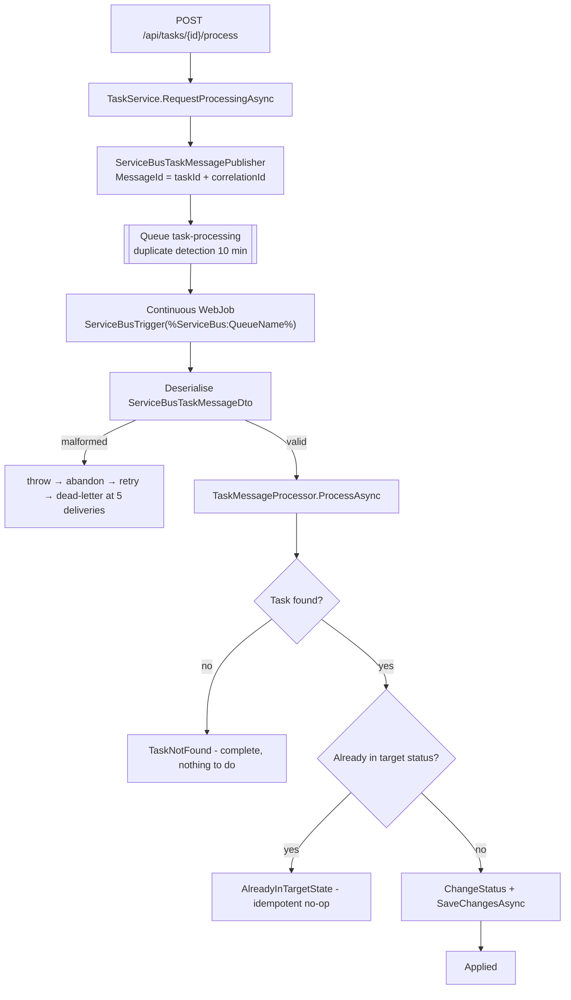
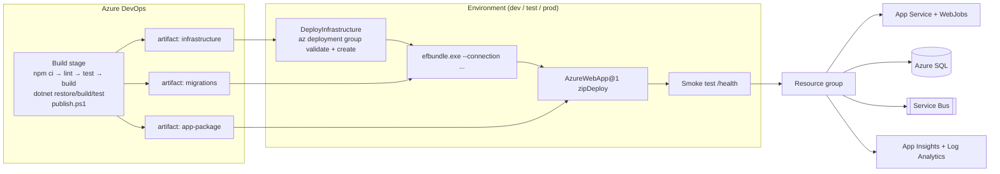

# Architecture

## Component responsibilities

| Component | Responsibility | Key types |
|---|---|---|
| `DemoTaskManager.Domain` | Business entity and its invariants. No framework dependencies. | `TaskItem`, `TaskStatus` |
| `DemoTaskManager.Contracts` | Wire contracts shared by the API, the WebJobs and the Angular models. | `TaskItemDto`, `CreateTaskItemRequest`, `UpdateTaskItemRequest`, `ProcessTaskItemRequest`, `PagedResultDto<T>`, `ServiceBusTaskMessageDto`, `ApiErrorDto`, `TaskQueryParameters` |
| `DemoTaskManager.Application` | Use cases, abstractions, validation and explicit mapping. | `ITaskService`/`TaskService`, `IReminderService`/`ReminderService`, `ITaskMessageProcessor`/`TaskMessageProcessor`, `ITaskRepository`, `ITaskMessagePublisher`, `IDateTimeProvider`, `IRequestValidator`, `TaskItemMappingExtensions` |
| `DemoTaskManager.Infrastructure` | EF Core persistence and Azure integrations. | `AppDbContext`, `TaskItemConfiguration`, `TaskRepository`, `ServiceBusTaskMessagePublisher`, `NullTaskMessagePublisher`, `SystemDateTimeProvider`, `DbInitializer` |
| `DemoTaskManager.Api` | HTTP surface, middleware pipeline, SPA hosting, health checks. | `TasksController`, `GlobalExceptionHandler`, `CorrelationIdMiddleware`, `SecurityHeadersMiddleware`, `HealthResponseWriter` |
| `DemoTaskManager.Web` | Angular 22 SPA. | `App`, `TaskListPage`, `TaskDetailPage`, `TaskFormPage`, `TaskApiService`, `ApiClient`, interceptors, guards |
| `DemoTaskManager.ScheduledWebJob` | Triggered WebJob running one reminder batch per schedule. | `Program` |
| `DemoTaskManager.ServiceBusWebJob` | Continuous WebJob consuming `task-processing`. | `Program`, `TaskProcessingFunctions` |

Dependency direction is strictly inward:

```
Api ──► Infrastructure ──► Application ──► Contracts ──► Domain
ScheduledWebJob ──┘              │
ServiceBusWebJob ─┘              └──────────────────────► Domain
```

Controllers never return EF Core entities. `TaskItem` leaves the Application layer only as
a `TaskItemDto` produced by explicit mapping extension methods — no reflection-based mapper.

## System diagram



## Angular request flow

1. `bootstrapApplication(App, appConfig)` starts the app; there is no `NgModule`.
2. `provideAppInitializer(loadRuntimeConfig)` fetches `/config.json` through `HttpBackend`
   (bypassing interceptors) and stores it in the `AppConfigService` signal. This is what
   makes the API base URL configurable per environment **without rebuilding the bundle**.
3. Routes are lazy: `app.routes.ts` loads `features/tasks/task.routes.ts`, which
   `loadComponent`s each page. `withComponentInputBinding()` binds the `:id` route
   parameter straight to the component `input.required<string>()`.
4. `validTaskIdGuard` (functional `CanActivateFn`) rejects malformed GUIDs before any HTTP
   call; `unsavedChangesGuard` (functional `CanDeactivateFn`) protects dirty forms.
5. Components call `TaskApiService` → `ApiClient`, which emits URLs prefixed with `api://`.
6. Interceptors run in order:
   - `apiBaseUrlInterceptor` rewrites `api://tasks` to `<runtime base URL>/tasks`
   - `correlationIdInterceptor` adds `X-Correlation-Id`
   - `loadingInterceptor` increments/decrements the global progress signal
   - `errorInterceptor` converts `HttpErrorResponse` into a typed `AppError`
7. `400` responses stay inline next to the offending form controls; everything else becomes
   a toast that shows the correlation id for support.
8. The list page composes signals (`status`, `search`, `pageNumber`, `pageSize`) into a
   `computed` query, converts it with `toObservable`, `switchMap`s to the API and converts
   the result back with `toSignal`. Typing is debounced separately so status and paging
   changes take effect immediately.



## API request flow



Endpoints:

| Method | Route | Success | Notes |
|---|---|---|---|
| GET | `/api/tasks` | 200 | `status`, `pageNumber`, `pageSize`, `search`; ordered by `CreatedAtUtc DESC, Id ASC` |
| GET | `/api/tasks/{id}` | 200 | 404 ProblemDetails when missing |
| POST | `/api/tasks` | 201 | `Location` header points at the new resource |
| PUT | `/api/tasks/{id}` | 200 | 404 when missing |
| DELETE | `/api/tasks/{id}` | 204 | 404 when missing |
| POST | `/api/tasks/{id}/process` | 202 | Publishes `ServiceBusTaskMessageDto` |
| GET | `/health` | 200 | Includes the SQL check |
| GET | `/health/live` | 200 | Liveness only |
| GET | `/config.json` | 200 | SPA runtime configuration |

Everything else falls back to `index.html`, except `/api`, `/health` and `/swagger`, which
return a JSON 404.

## Scheduled WebJob flow



**Concurrency approach.** The conditional `UPDATE` is the concurrency control. Two
overlapping executions issue the same statement; the database serialises them and only one
observes an affected row count of `1`. Reminder dispatch happens only for that winner, so
handling is naturally idempotent and no distributed lock or storage account is required.
`Reminders__GraceMinutes` shifts the due-date threshold so freshly overdue tasks can be
deferred. The job processes one batch and exits — never an in-process timer loop.

## Service Bus WebJob flow



Failure handling:

- Exceptions are never swallowed. Transient faults (for example `TimeoutException`) bubble
  out so the WebJobs SDK abandons the message and Service Bus redelivers it.
- Duplicate delivery is safe because `ProcessAsync` short-circuits when the task already has
  the requested status, and the broker also drops duplicate `MessageId`s within 10 minutes.
- Logging uses a scope carrying `MessageId`, `CorrelationId` and `DeliveryCount`. The
  message body is never written to logs.

## Deployment package structure

```
DemoTaskManager.zip
├── DemoTaskManager.Api.dll, *.dll, appsettings.json, web.config
├── wwwroot/
│   ├── index.html
│   ├── main-<hash>.js, chunk-<hash>.js, styles-<hash>.css
│   ├── config.json                (static fallback; /config.json is served dynamically)
│   └── favicon.ico
└── App_Data/
    └── jobs/
        ├── triggered/
        │   └── reminder-sweep/
        │       ├── run.cmd
        │       ├── settings.job          {"schedule": "0 */15 * * * *"}
        │       ├── appsettings.json
        │       └── DemoTaskManager.ScheduledWebJob.dll + dependencies
        └── continuous/
            └── task-processor/
                ├── run.cmd
                ├── settings.job          {"is_in_place": false, "stopping_wait_time": 60}
                ├── appsettings.json
                └── DemoTaskManager.ServiceBusWebJob.dll + dependencies
```

`WEBSITE_RUN_FROM_PACKAGE` is set to `0` because triggered WebJobs need a writable
`App_Data` folder. The package is delivered with zip deploy.



## Security decisions

| Area | Decision |
|---|---|
| SQL injection | Every query is an EF Core LINQ expression, so the provider always emits parameterised SQL. No string concatenation, no raw SQL. |
| Page size abuse | `TaskQueryParameters` clamps `pageSize` to 100 and `pageNumber` to ≥ 1 on assignment, before the value can reach the database. |
| Entity exposure | Controllers return DTOs only; `TaskItem` has private setters and a factory method. |
| Error responses | RFC 9457 ProblemDetails. Stack traces appear only in Development; production returns a generic message plus a correlation id. |
| Correlation | `CorrelationIdMiddleware` reuses an inbound `X-Correlation-Id` (truncated to 128 chars) or falls back to `TraceIdentifier`, echoes it, and adds it to the log scope and every ProblemDetails. |
| Secrets in logs | Health output omits exception detail; the Service Bus WebJob logs identifiers only; `NullTaskMessagePublisher` logs ids, not payloads. |
| Transport | `httpsOnly`, HSTS outside Development, TLS 1.2 minimum, FTPS disabled. |
| Response headers | `X-Content-Type-Options`, `X-Frame-Options: DENY`, `Referrer-Policy: no-referrer`, `Permissions-Policy`, and a CSP with `frame-ancestors 'none'`. |
| Managed identity | System-assigned identity holds only *Azure Service Bus Data Sender* and *Data Receiver*, scoped to the namespace. |
| SQL credentials | Supplied as secure Bicep parameters / Azure DevOps secret variables and written to App Service connection strings. Never in source control, never in pipeline YAML, never in outputs. |
| Migrations | Applied by `efbundle.exe` from the pipeline. `Database.Migrate()` runs only in Development. |
| Cancellation | `CancellationToken` flows from controller and queue trigger through service, repository and EF Core. |
| Dates | UTC everywhere; a `ValueConverter` restores `DateTimeKind.Utc` on read. |
| Frontend | `strict: true`, `strictTemplates: true`, ESLint over TypeScript **and** templates, hidden source maps in production. |
| CORS | Only enabled in Development for `localhost:4200`; deployed builds are same-origin. |

## Switching SQL to managed identity

The demo uses SQL authentication. To move to managed identity:

1. Set `sqlEntraAdminObjectId` / `sqlEntraAdminLogin` so an Entra principal is the SQL admin.
2. Connect as that principal and run:
   ```sql
   CREATE USER [<app-service-name>] FROM EXTERNAL PROVIDER;
   ALTER ROLE db_datareader ADD MEMBER [<app-service-name>];
   ALTER ROLE db_datawriter ADD MEMBER [<app-service-name>];
   ALTER ROLE db_ddladmin  ADD MEMBER [<app-service-name>];
   ```
3. Change the connection string to
   `Server=tcp:<server>.database.windows.net,1433;Initial Catalog=<db>;Authentication=Active Directory Default;Encrypt=True;`
4. Give the migration pipeline identity the same database roles.

The trade-off is that step 2 requires an interactive or federated SQL session that Bicep
cannot perform, which is why it is opt-in rather than the default for this demo.
